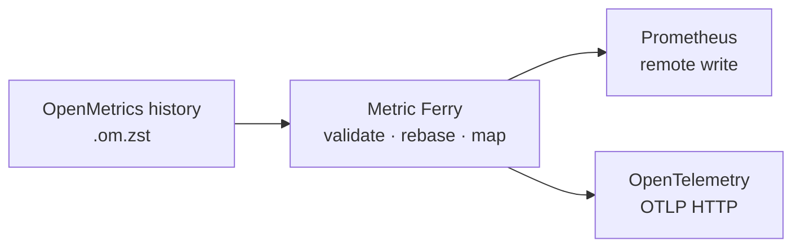

# Metric Ferry

**Bring your metrics history along.**

Import archived OpenMetrics into **Prometheus remote write**, **OpenTelemetry
(OTLP HTTP/protobuf)**, or both. Shift old samples to the present, preserve their
relative timing, and stream compressed histories with a single Go binary.

[](https://github.com/JohanLindvall/metric-ferry/actions/workflows/ci.yml)
[](go.mod)
[](LICENSE)

[Quick start](#quick-start) · [Usage reference](docs/usage.md) ·
[Examples](examples/README.md) · [Contributing](CONTRIBUTING.md)



## Why Metric Ferry?

- **Backfill a metrics backend.** Load timestamped histories from compressed text
  exports, with validation before you send.
- **Make demos repeatable.** Rebase an archive to `now` or a fixed timestamp while
  retaining the spacing between samples.
- **Compare two ingestion paths.** Send the same history to Prometheus and OTLP
  receivers in one decoding pass, with OTLP semantic attribute mapping.
- **Keep the import self-contained.** Native zstd decoding, bounded buffers,
  ordered worker queues, and compressed requests. No external decompressor,
  Collector, or metrics SDK is required by the importer.

## Quick start

Requires **Go 1.26 or newer**. Try the bundled synthetic history without a server:

```sh
git clone https://github.com/JohanLindvall/metric-ferry.git
cd metric-ferry
go build -o metric-ferry .
./metric-ferry -input examples/demo.om.zst -dry-run -progress 0
```

The demo contains **12 samples across 3 series**: a request counter, an in-flight
request gauge, and a duration gauge. A successful dry run reports `samples=12`,
`series=3`, `prometheus=12`, and `otlp=12`. It validates and encodes both protocols
without making network requests. [Inspect or regenerate the demo](examples/README.md).

To install the CLI on your Go binary path:

```sh
go install github.com/JohanLindvall/metric-ferry@latest
metric-ferry -help
```

### Send an archive

Supply either destination flag, or both. This example sends the demo to local
receivers and moves the newest sample to the current time:

```sh
./metric-ferry -input examples/demo.om.zst -rebase now \
  -prometheus-url http://localhost:9090/api/v1/write \
  -otlp-url http://localhost:4318/v1/metrics
```

Start your receivers first. Prometheus needs
[`--web.enable-remote-write-receiver`](https://prometheus.io/docs/prometheus/latest/command-line/prometheus/).
OTLP requires an HTTP/protobuf metrics endpoint, typically on port `4318`.
Use a dedicated test destination for the demo; receiver retention, age, and
out-of-order limits still apply.

For your own data, replace the input path with a zstd-compressed, timestamped
OpenMetrics/Prometheus text history. Run `-dry-run` on the full archive first.
[Authentication, timestamps, mappings, and tuning →](docs/usage.md)

## What to expect

| Capability | Behavior |
| --- | --- |
| Input | zstd-compressed scalar text samples with explicit timestamps; file or stdin |
| Destinations | Prometheus remote write and OTLP HTTP/protobuf, independently or together |
| Time handling | Fixed shifts or rebasing; nanosecond parsing, millisecond remote write |
| Attribute mapping | Known OTel semantic keys, resource attributes, and explicit overrides |
| Delivery | Per-series ordering, bounded batches, retries, and HTTP 413 batch splitting |
| Validation | Dry runs use the same parsing, mapping, and encoding as imports |

A previously recorded local dry run processed **20.7 million samples in 70.9
seconds** while encoding both outputs—about **293,000 input samples/second**.
That measures local processing, not receiver ingestion. Hardware, memory usage,
and limitations are recorded in the [usage reference](docs/usage.md#throughput-and-delivery);
[benchmark your own data](docs/benchmarks.md) before sizing an import.

Metric Ferry sends history as fast as the receiver accepts it; it does not pace
samples in real time. Histogram and summary components remain scalar series.
Delivery can be partial, and there is no persistent checkpoint/resume mechanism.
See the [input contract](docs/usage.md#metric-types-and-input-contract) and
[delivery semantics](docs/usage.md#throughput-and-delivery) before importing production data.

## Help and contributions

[Report a bug or propose a feature](https://github.com/JohanLindvall/metric-ferry/issues/new/choose).
Useful contributions include small reproduction archives, receiver compatibility
reports, documentation fixes, and benchmarks with hardware and command details.
See [CONTRIBUTING.md](CONTRIBUTING.md) to run the tests and prepare a change.

For vulnerabilities, follow [SECURITY.md](SECURITY.md). Keep discussions respectful
and follow the [code of conduct](CODE_OF_CONDUCT.md).

## License

[MIT](LICENSE) © 2026 Johan Lindvall.
